---

<table>
<tr>
<td valign="top" width="48%">

<h2>About Me</h2>

Robotics &amp; Digital Systems Engineering student at <b>Tecnológico de Monterrey</b> (graduating December 2026), focused on <b>autonomous driving</b>.

I've built autonomous systems end to end: <b>vision-based perception</b> with YOLOv8 and fisheye calibration, <b>LiDAR SLAM</b>, <b>EKF sensor fusion</b> and <b>ROS 2</b> integration on Jetson, STM32 and FPGA hardware.

Right now I'm working on a vision-based autonomous driving project, and I'm looking for roles in <b>geometric vision</b> and <b>self-driving</b>.

</td>
<td align="center" valign="middle" width="52%">

</td>
</tr>
</table>

---

## Experience & Leadership

🦾 **Team Leader — Quanser Mechatronics Challenge** · Markham, Ontario, Canada · Nov 2025
> Built a robotic arm from scratch with a YOLO/OpenCV cube-sorting pipeline and hand-gesture teleoperation. Earned a Quanser training certification.

👨‍🏫 **Robotics Instructor (Social Service)** · Tecnológico de Monterrey / SMALC · 2025
> Taught robotics, programming and electronics through hands-on projects.

🎓 **B.Eng. Robotics and Digital Systems** · Tecnológico de Monterrey · Expected Dec 2026

---

## Featured Projects

### 🚗 [Autonomous Driving PuzzleBot](https://github.com/StrPicket/Puzzlebot_Challenge)
*Jan – Jun 2025 · Team lead (5 people)*

 ▶ Click to watch the demo

Autonomous driving system running fully on-board a fisheye-camera PuzzleBot. A YOLOv8 model recognizes traffic signs, classical vision handles lanes and traffic lights, and a finite-state machine turns those signals into safe driving decisions, all organized as a modular ROS 2 architecture.

**Tools:**    

**Concepts & skills:** traffic-sign recognition, lane and traffic-light detection, fisheye camera, finite-state machines, modular ROS 2 architecture, field testing, team leadership.

 
 

---

 
 

### 📦 Autonomous Warehouse PuzzleBot
*Jan – Jun 2026 · Team lead (5 people)*

 ▶ Click to watch the demo

Autonomous forklift that maps a warehouse with LiDAR SLAM, plans routes with A\*/Dijkstra, avoids obstacles with Bug2 and localizes by fusing AprilTag/QR camera poses in an EKF. A ROS 2-controlled FPGA mechanism handles the pallet lifting.

**Tools:**     

**Concepts & skills:** SLAM (particle filter), EKF sensor fusion, camera calibration, PnP pose estimation, A\*/Dijkstra, Bug2, SPI communication, Agile/Scrum, V-Model.

 
 

---

 
 

### 🚁 Cooperative UAVs for Oil-Leak Monitoring
*Aug – Dec 2025 · Technical lead (5 people)*

 ▶ Click to watch the demo

Two cooperating drones for inspection: a YOLO segmentation model and visual servoing let the first drone detect and log hazards by severity, and the second flies to each point to re-inspect and verify it.

**Tools:**   

**Concepts & skills:** instance segmentation, image-based visual servoing, PD control, multi-agent coordination, system architecture, technical leadership.

 
 

---

 
 

### 🦾 Quanser Mechatronics Challenge
*Nov 2–7, 2025 · Markham, Ontario, Canada · Team leader*

 ▶ Click to watch the demo

Robotic arm built from scratch with Quanser actuators and sensors. A YOLO/OpenCV pipeline detects cubes by color for autonomous sorting and was extended to control the arm's joints and gripper with hand gestures. Earned a Quanser training certification.

**Tools:**   

**Concepts & skills:** actuator and sensor integration, robotic arm control, color-based object detection, gesture teleoperation, troubleshooting under time pressure, team leadership.

 
 

---

 
 

### 🚜 Autonomous Tractor Prototype (John Deere)
*Aug – Dec 2024 · Industry partner: John Deere*

Embedded control system for an autonomous tractor prototype on an STM32: motor control with encoders, GPS waypoint navigation, IMU tracking, and CAN and wireless communication between modules.

**Tools:**    

**Concepts & skills:** embedded firmware, PWM and encoder control, waypoint navigation, inertial sensing, CAN bus, wireless telemetry.

 
 

---

 
 

### ⚙️ Embedded Systems Projects
*Academic projects*

 ▶ Click to watch the demo

A real-time vehicle simulation with FreeRTOS tasks and a Raspberry Pi GUI, plus an FPGA vehicle-control interface that steers with an accelerometer and talks to Unity over UART.

**Tools:**    -5E35B1?style=flat-square) 

**Concepts & skills:** real-time operating systems, task synchronization, hardware/software co-design, UART, GUI development.

---

## Tech Stack

**Programming & Vision**

      

**Autonomous Systems**

    

**Hardware & Communication**

     

**Tools**

    

---

## Currently

🔭 **Working on:** a vision-based autonomous driving project, with vision as the main source of perception.

🎯 **Looking for:** roles focused on **geometric vision** and **self-driving**.

  

---

### Let's Connect

*Open to geometric vision & self-driving roles — graduating December 2026*

